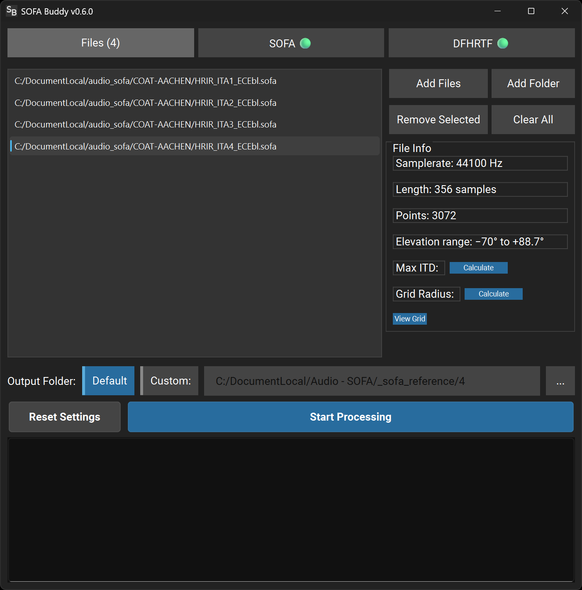
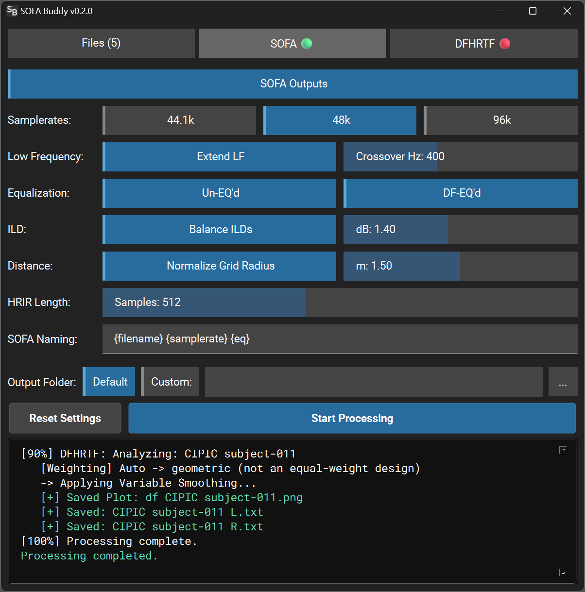
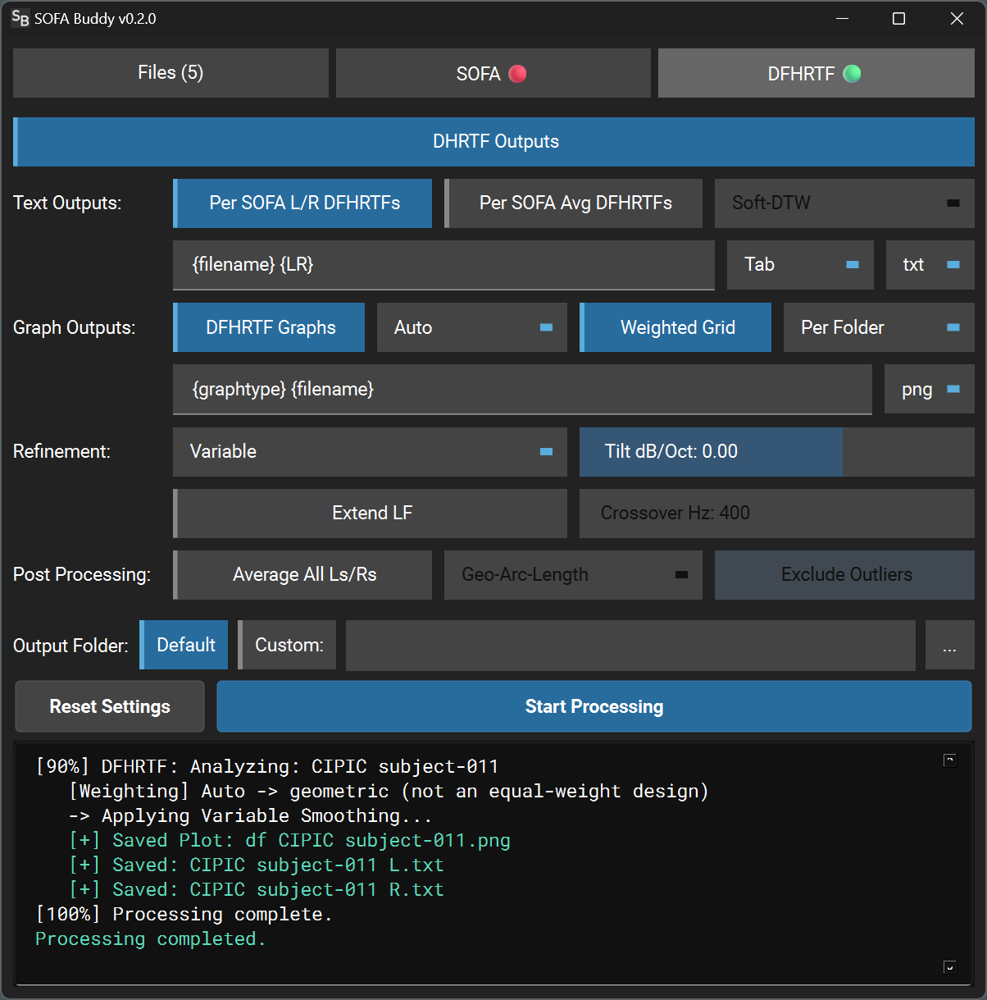
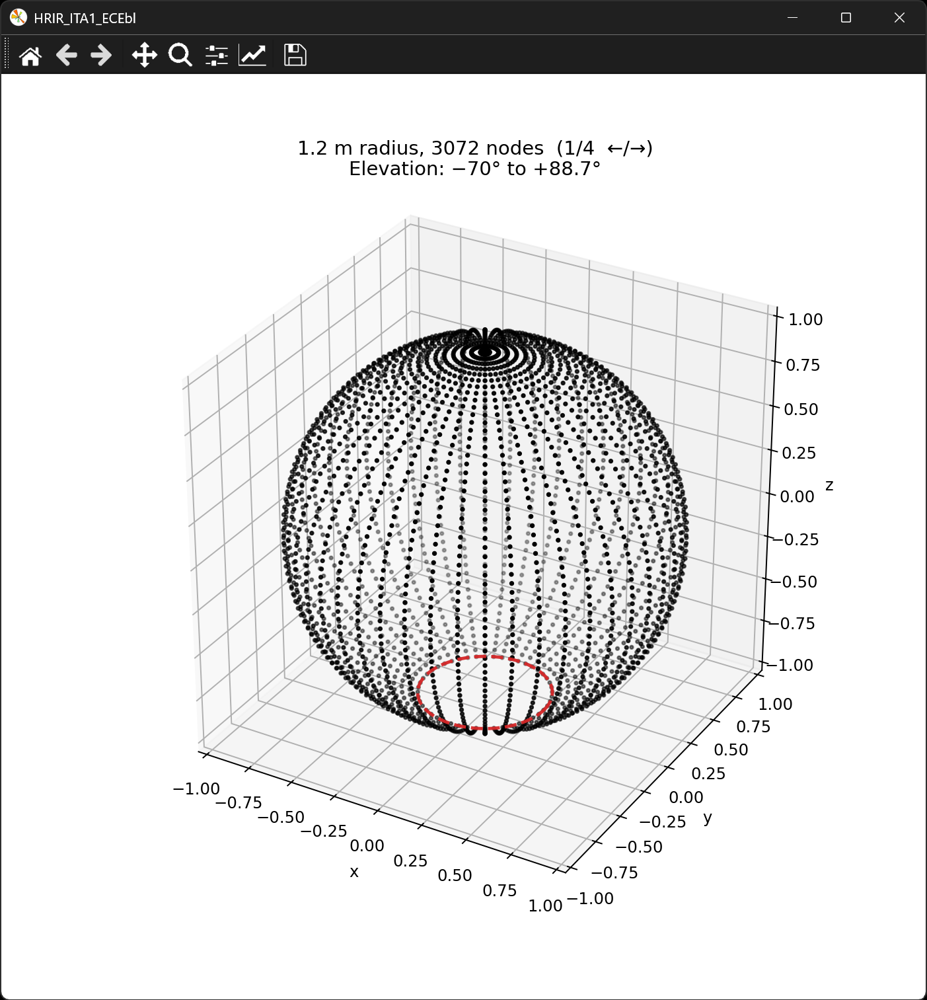
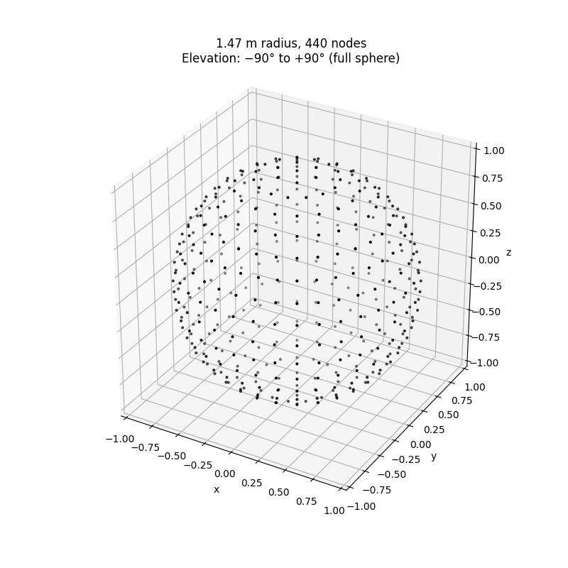
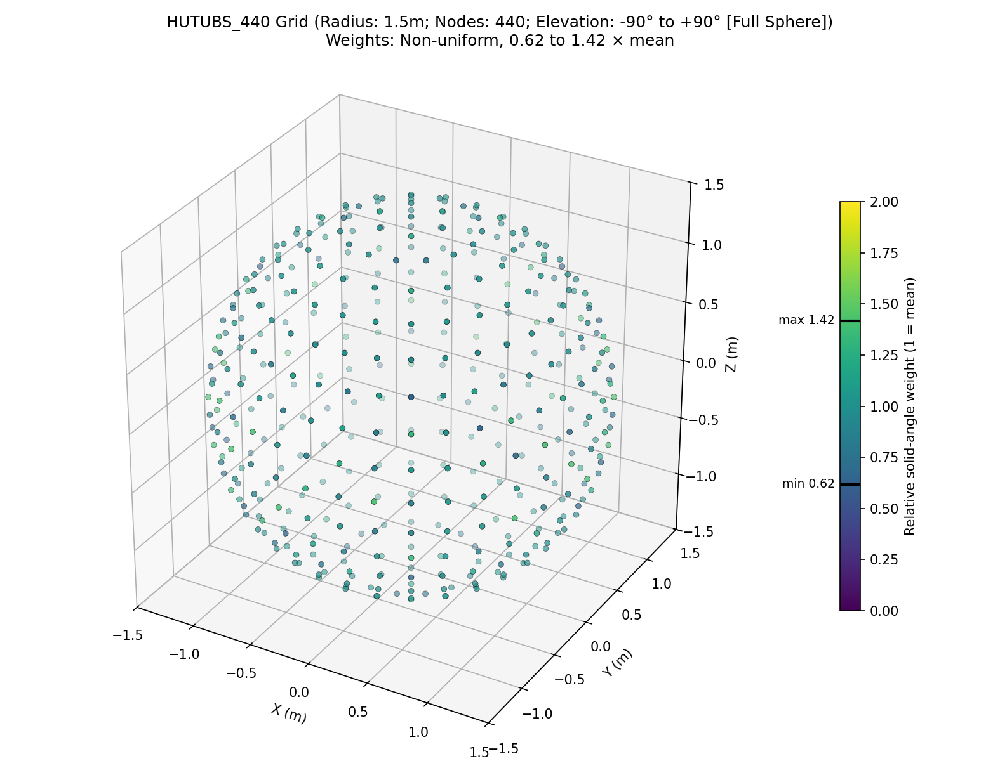

# SOFA Buddy

A desktop GUI for mastering SOFA HRTF files and extracting diffuse-field HRTF (DFHRTF) responses.

**SOFA** (Spatially Oriented Format for Acoustics) is the standard file format for head-related transfer functions (HRTFs) — the acoustic fingerprint of how sound reaches your ears from different directions. A **diffuse-field HRTF (DFHRTF)** is the average spectral response across all measurement directions, solid-angle-weighted to account for uneven spatial sampling; it characterizes the coloration introduced by the head and ears independent of sound direction, and is used for headphone equalization, quality analysis, and comparing HRTFs across measurement labs.

## Screenshots





## Features

- **Two-stage processing pipeline**: SOFA mastering (resample, LF extension, DF equalization, radius normalization, crop/window to target length) → DFHRTF extraction (smoothed magnitude curves and plots)
- **Parallel batch processing**: jobs are grouped into chunks and run concurrently through a bounded worker pool (default: half of CPU cores), with per-file progress and failure reporting; worker subprocesses run at reduced priority so the GUI stays responsive during full-core runs
- **Multiple samplerates** in one run: 44.1 kHz, 48 kHz, 96 kHz
- **Geometry-weighted diffuse-field calculation** using convex-hull solid-angle weights (accounts for hemispherical measurement grids missing lower elevations)
- **Variable smoothing** (default): frequency-dependent smoothing with a Gaussian window (or a flat one, by setting) on a log-frequency axis, defined by an editable list of points: by default 1/2 octave at low frequencies narrowing to 1/12 octave by 6 kHz, held to 14 kHz, then widening to 1/4 octave by 17.5 kHz; fixed 1/3–1/48-octave smoothing uses the same smoother, so wherever the Variable profile is held at 1/12 it is identical to fixed 1/12. Averaging is in power by default, and data above 20 kHz (the measurement's anti-alias roll-off) is left out of every window
- **Hybrid smoothing** (optional): an adaptive smoother that bridges narrow measurement ripple below about 7 kHz while keeping the narrow peaks and notches above it that come from the pinna, and rejects single-bin glitches (see below)
- **Three averaging algorithms** for global and per-SOFA averages: Arithmetic Mean, Geo-Arc-Length, and Soft-DTW barycenter
- **Outlier exclusion** filters anomalous curves before averaging
- **Grid visualization**: inspect measurement grids as 3D scatter plots; export solid-angle weight maps
- **Flexible filename templates** with `{filename}`, `{folder}`, `{samplerate}`, `{eq}`, `{tilt}`, `{smoothing}`, `{LR}`, `{graphtype}`, and `{algo}` variables
- **Config persistence**: all settings auto-save and restore across sessions; Reset Settings returns to factory defaults
- **Default and Custom output folder modes**

## Installation

Requires Python 3.10+.

```bash
pip install -r requirements.txt
```

UI tests additionally require `pytest-qt` (not in `requirements.txt`):

```bash
pip install pytest-qt
```

## Quick Start

1. Launch the app:
   ```bash
   python main.pyw
   ```
2. On the **Files** tab, click **Add Files** or **Add Folder** to load `.sofa` files.
3. Enable **SOFA Outputs** on the SOFA tab and/or **DFHRTF Outputs** on the DFHRTF tab.
4. Choose an Output Folder mode (Default or Custom) at the bottom of the Files tab.
5. Click **Start Processing**.

## The Three Tabs

### Files Tab

The Files tab manages your input files and output destination.

- **File list**: User can drag and drop .sofa files anywhere on the app window, add `.sofa` files individually (**Add Files**) or scan a whole folder (**Add Folder**). Select a file to view its metadata — samplerate, impulse-response length, measurement point count, elevation range, and optionally Max ITD and Grid Radius (computed on demand via their **Calculate** buttons).
- **View Grid**: Opens a 3D scatter plot of the selected file's measurement grid. The window is titled with the source filename so multiple plots stay identifiable. The plot title also shows the grid's elevation range, and dashed rings mark the lowest and highest elevation at open ends of partial grids (full-sphere grids are labelled as such), and the axes are fixed so grids can be compared at a glance.
- **Remove Selected / Clear All**: Remove individual files with the button or by right-clicking the list; **Clear All** empties everything.
- **Output Folder**:
  - **Default** — each source file's outputs land in `sofa_mastered/` and `DFHRTF/` subfolders next to that file. Files spanning multiple folders each get their own per-folder average.
  - **Custom** — all outputs go under a single chosen root folder. Global averaging produces one combined average across all files.

### SOFA Tab

Controls the SOFA mastering stage. Toggle **SOFA Outputs** on to enable.

| Setting | Description |
|---|---|
| Samplerates | Which output samplerates to produce: 44.1k / 48k / 96k |
| Extend LF | Replace sub-crossover magnitudes with an ideal reference curve |
| Crossover Hz | Transition frequency for LF extension (default 1000 Hz) |
| Un-EQ'd | Include unequalized SOFA output variants |
| DF-EQ'd | Include diffuse-field-equalized output variants |
| Normalize Grid Radius | Harmonize all HRIRs to a target measurement distance |
| Distance (m) | Target radius in metres (default 1.5 m) |
| Balance ILDs | Estimate diffuse-field inter-aural level difference and correct it with a symmetric split-level gain when it exceeds the threshold |
| ILD Threshold (dB) | Correction trigger threshold (default 1.2 dB) |
| HRIR Length | Output impulse-response length in samples (default 256 — spectrally equivalent to 512 given the 1 kHz LF crossover, at half the file size) |
| SOFA Naming | Filename template for output `.sofa` files |

### DFHRTF Tab

Controls DFHRTF extraction and averaging. Toggle **DFHRTF Outputs** on to enable. When SOFA Outputs are also enabled the mastered SOFAs are used as the source (files whose mastering failed are skipped, never silently analyzed raw); otherwise the raw imported files are used.

**Text Outputs**

| Setting | Description |
|---|---|
| Per SOFA L/R DFHRTFs | Separate left-ear and right-ear DFHRTF magnitude text files per source SOFA |
| Per SOFA Avg DFHRTFs | Averaged L+R DFHRTF magnitude text file per source SOFA |
| Avg Algo | Algorithm for the per-SOFA L+R average |
| Text filename | Filename template for text output files |
| Delimiter | Tab, Comma, Semicolon, or Space |
| Extension | `txt` or `csv` |

**Graph Outputs**

| Setting | Description |
|---|---|
| DFHRTF Graphs | Diffuse-field response plots (L and R overlayed) |
| Stereo Graphs | ±30° frontal-plane plots (left-ear left channel, right-ear right channel) |
| Weighted Grid | Solid-angle weight map of the measurement grid |
| Scope | **Per Folder**: one representative plot per source folder; **All Files**: one plot per SOFA file |
| Graph filename | Filename template for graph output files |
| Extension | `png` or `jpg` |

**Refinement**

| Setting | Description |
|---|---|
| Smoothing | **Variable** (default): frequency-dependent smoothing — a window 1/2 octave wide at low frequencies easing to 1/12 octave in the mids, then heavier again to 1/4 octave in the top octave (see below); **Hybrid**: adaptive smoothing that keeps real narrow pinna peaks and notches above about 7 kHz (see below); or a fixed 1/N-octave window: 1/3, 1/6, 1/12, 1/24, or 1/48. Variable and fixed smoothing use the same method (see below) |
| Tilt dB/Oct | Spectral tilt centered at 1 kHz (range −2 to +1 dB/oct) |
| Extend LF | Linearize sub-crossover frequency response |
| Crossover Hz | Transition frequency for LF extension (default 1000 Hz) |

Every smoothing mode (including the ±30° stereo graph) uses one smoother: a window of nominal width 1/N octave on a log-frequency axis, integrated exactly between FFT bins, so each octave inside the window counts equally. `dfhrtf.advanced.smoothing_window` picks the window shape: `gaussian` (default) or `flat` (rectangular). Both have the same variance, so 1/N means the same amount of smoothing in either; the Gaussian never inverts the peaks and dips of a ripple (a flat window does for ripple periods between half and one window width). Set `flat` to reproduce output from before the Gaussian was added. Only data up to 20 kHz is used; a window that reaches 20 kHz is cut there and renormalised, so the roll-off above 20 kHz never bleeds into the top of the band.

Variable smoothing's width is a list of points in `user_settings.json`, `dfhrtf.advanced.variable_smoothing_profile`. Each point is `{"freq": Hz, "n": N}` (window 1/N octave wide) with an optional `"gamma"`. Below the first point the width is held at the first point's, above the last point at the last point's; between two points the width is interpolated over log-frequency, warped by t^gamma (1.0 = linear, below 1 moves the transition toward the earlier point, above 1 toward the later one). `gamma` belongs to the point a ramp arrives at, so it is not allowed on the first point. Two neighbouring points with the same `n` make a hold, and a single point is fixed 1/N. Frequencies must strictly increase (20–20000 Hz), `n` is 1–48, `gamma` 0.1–10. The default is a starting point:

```json
"variable_smoothing_profile": [
  {"freq": 350,   "n": 2},
  {"freq": 6000,  "n": 12, "gamma": 0.88},
  {"freq": 14000, "n": 12},
  {"freq": 17500, "n": 4,  "gamma": 1.6}
]
```

That is 1/2 octave at/below 350 Hz easing to 1/12 octave by 6 kHz, held until 14 kHz, then heavier smoothing up to 1/4 octave at 17.5 kHz and above, which tames the unreliable top-octave detail. Settings from older versions are converted automatically on first launch (you get a one-time message). `dfhrtf.advanced.smoothing_mean_mode` sets how values inside a window are averaged for all modes: `power` (default, mean of 10^(dB/10)), `db` (mean of dB, favours nulls) or `cubic` (REW-style, favours peaks).

**Hybrid smoothing** is meant for 1/48-octave DFHRTF curves. The raw spectrum is first smoothed to the 1/48-octave grid (using `smoothing_window` and `smoothing_mean_mode` as above), then two regimes are applied and joined by a logistic crossfade in log-frequency:

- below the crossover (7350 Hz by default), narrow dips are treated as measurement artefacts (rig reflections, concha jitter): a smoothing spline bridges them, with weights reduced wherever a total-variation denoiser sees ripple;
- above it, narrow peaks and deep notches are real pinna cues: a Huber-reweighted local cubic fit (9 bins, about 0.19 octave) throws out 1-2 bin spikes such as the 14.69 kHz glitch in some HUTUBS files, while multi-bin notches and peaks keep their depth. A notch narrower than about 3 bins is treated as a glitch.

Nine JSON-only settings tune it, all under `dfhrtf.advanced`: `hybrid_xover_hz` (7350, range 5500–9000; unrelated to the LF-extension crossover `dfhrtf.xover`), `hybrid_xover_width_oct` (0.08), `hybrid_tv_weight` (0.65), `hybrid_s_factor` (3.0, range 0.5–10), `hybrid_s_min` (4.0) and `hybrid_s_max` (12.0) (both 0.5–30, min must not exceed max; see below), `hybrid_huber_window` (9; odd, 5–15), `hybrid_huber_delta` (0.12 dB, range 0.05–0.30: lower rejects spikes harder, higher approaches plain Savitzky-Golay smoothing) and `hybrid_huber_iter` (6). Notes: spectral tilt and LF extension are applied after smoothing, as in every mode; and the spline weight boost above the crossover follows `hybrid_xover_hz` (the original algorithm hard-coded 7500 Hz, so with the default 7350 Hz the boost starts one or two bins earlier than in the version it was first validated on; because the spline's budget is shared across the curve, this moves the result by up to about 0.3 dB in places).

How hard the low/mid spline smooths (its smoothness `s`) is chosen separately for every curve, so the left and right ears, which on measured datasets can differ a lot, each get their own value. The spline's `s` is a budget for the whole curve: a noisy measurement (the ARI datasets, for example) spends a fixed budget on broad noise and keeps its narrow ripple, while a budget big enough for those over-smooths clean curves (HUTUBS, COAT) and erases real detail such as small shoulders. So the app measures each curve's noise (the RMS of the ripple the total-variation denoiser removes below the crossover, `sigma`) and sets `s = hybrid_s_factor x 479 x sigma^2`, limited to between `hybrid_s_min` and `hybrid_s_max`: clean curves get about 4, noisy ones up to 12. Raise `hybrid_s_factor` to smooth more everywhere, or set `hybrid_s_min` equal to `hybrid_s_max` to force one fixed `s`. The values used are printed in the job log (`-> Hybrid s: L 9.4, R 9.0`) and shown in the graph subtitle (`Smoothing: Hybrid (s L 9.4, R 9.0)`) of the diffuse-field and ±30° stereo graphs; averaged graphs, built from many already-smoothed curves, just say `Hybrid`.

**Post Processing — global averaging**

| Setting | Description |
|---|---|
| Average All Ls/Rs | Compute a global average across all Per SOFA L/R outputs (requires Per SOFA L/R to be on) |
| Algo | Averaging algorithm (see below) |
| Exclude Outliers | Filter curves more than 1 std deviation above the median pairwise distance |

## Output Layout

With **Default** output mode and the default naming templates:

```
<source folder>/
├── sofa_mastered/
│   └── <name> <samplerate> <eq>.sofa
└── DFHRTF/
    ├── <name> L.txt
    ├── <name> R.txt
    ├── df <name>.png
    ├── stereo <name>.png
    ├── weighted <name>.png
    └── <folder> avg L.txt / <folder> avg R.txt    ← global average for this folder
```

With **Custom** output mode the same structure lands under the chosen root and one global average spans all files.

## Filename Template Variables

All filename fields support substitution variables enclosed in `{` `}`:

| Variable | Expands to | Available in |
|---|---|---|
| `{filename}` | Source SOFA filename (no extension) | SOFA naming, DFHRTF text, DFHRTF graphs, per-SOFA average |
| `{folder}` | Source file's parent folder name | SOFA naming, DFHRTF text, DFHRTF graphs, per-SOFA average, global average |
| `{samplerate}` | Output samplerate (e.g. `48000`) | SOFA naming, DFHRTF text, per-SOFA average (global average: `all`) |
| `{eq}` | EQ variant: `uneq` or `dfeq` | SOFA naming only |
| `{tilt}` | Spectral tilt value in dB/oct (e.g. `0.0`, `-0.5`) | DFHRTF text, DFHRTF graphs, per-SOFA average, global average |
| `{smoothing}` | Smoothing setting with `/` replaced by `-`: `Variable`, `Hybrid`, `1-3`, `1-6`, `1-12`, `1-24` or `1-48` | DFHRTF text, DFHRTF graphs, per-SOFA average, global average |
| `{LR}` | Channel: `L` or `R`; `Avg` for the per-SOFA average | DFHRTF text, per-SOFA average, global-average text |
| `{graphtype}` | Plot type: `df`, `stereo`, or `weighted` | DFHRTF graphs, global-average graph |
| `{algo}` | Short algorithm name: `arithmean`, `geoarc`, `softdtw` | Global-average text files only |

The average outputs have their own templates, set only in `user_settings.json` for now (no field in the app yet): `dfhrtf.per_sofa_avg_filename` (default `{filename} avg LR`; `{algo}` is dropped), `dfhrtf.avg_filename` (default `{folder} avg {LR}`, one file per ear) and `dfhrtf.avg_graph_filename` (default `{folder} avg`).

`{folder}` is especially useful in multi-folder batches: each output file is stamped with the name of its source folder, keeping files from different subjects or sessions distinct even when collected into a shared output directory.

## Averaging Algorithms

Three algorithms are available for both **global averages** (Post Processing) and **per-SOFA L+R averages**:

**Arithmetic Mean** — Point-by-point mean on the normalized log-frequency grid. Fast and straightforward; works well when curves are closely clustered.

**Geo-Arc-Length** — Iterative parametric blend that minimizes geometric arc-length error between the candidate average and each input curve. Better at preserving peaks and dips than a straight mean when curves vary in shape.

**Soft-DTW Barycenter** — L-BFGS-B optimization minimizing soft dynamic-time-warping loss (via `tslearn`). Most robust when curves differ in spectral shape or magnitude; slowest of the three.

**Outlier Exclusion** — Before averaging, curves beyond `median + N × std` of pairwise distances are discarded. The threshold `N`, DTW gamma, and other averaging tunables can be adjusted in `user_settings.json` under the `averaging` key.

## Grid Visualization

**View Grid** (Files tab) opens a 3D scatter plot of the measurement grid for the selected SOFA file, with the window title set to the source filename. The plot title shows the grid's elevation range (tagged "full sphere" when both poles are covered), dashed rings mark the open ends of partial grids, and the axes are fixed so grids can be compared at a glance.



**Weighted Grid** (DFHRTF tab) saves a plot of the solid-angle-weighted grid used in the DFHRTF calculation — node color encodes each node's relative solid-angle weight (weight x node count, so 1 = the mean) on a fixed 0 to 2 color range, so grids can be compared side by side. The colorbar marks the grid's lowest and highest weight (or "all = 1" for a uniform grid). Nodes left out of the DFHRTF calculation (off-radius or duplicate positions) are drawn grey. The title gives the radius, node count, elevation range and Full/Partial Sphere, with a second line summarising the weights; dashed boundary rings mark the open ends of partial grids. Use **Per Folder** scope for one representative plot per source folder, or **All Files** for a plot per SOFA file.




## Settings and Persistence

Settings are automatically saved to `user_settings.json` whenever you start processing or close the app. The next session restores all tab state from this file. **Imported file paths are never saved.**

| Platform | Location |
|---|---|
| Windows | `%LOCALAPPDATA%\SOFA Buddy\user_settings.json` |
| Linux | `~/.config/SOFA Buddy/user_settings.json` |
| macOS | `~/Library/Preferences/SOFA Buddy/user_settings.json` |

**Reset Settings** (main window toolbar) deletes `user_settings.json` and restores factory defaults.

Advanced tunables not exposed in the UI can be edited directly in `user_settings.json`. Keys live under `sofa.advanced`, `dfhrtf.advanced`, `averaging`, and `processing`. The app validates and sanitizes all JSON edits on load — out-of-range values are clamped and invalid choices are reverted to defaults with a warning in the console.

Parallel execution is tuned under the `processing` key: `max_workers` (default `0` = auto, half of CPU cores) sets the concurrent worker-pool size, and `chunk_size` (default `16`) sets how many files each worker subprocess handles per batch.

## Running Tests

```bash
pytest tests/                   # all tests (requires pytest-qt for UI tests)
pytest tests/test_config.py     # config tests only — no Qt dependency
```

## License

This project is licensed under the MIT License — see the [LICENSE](LICENSE) file for details.
