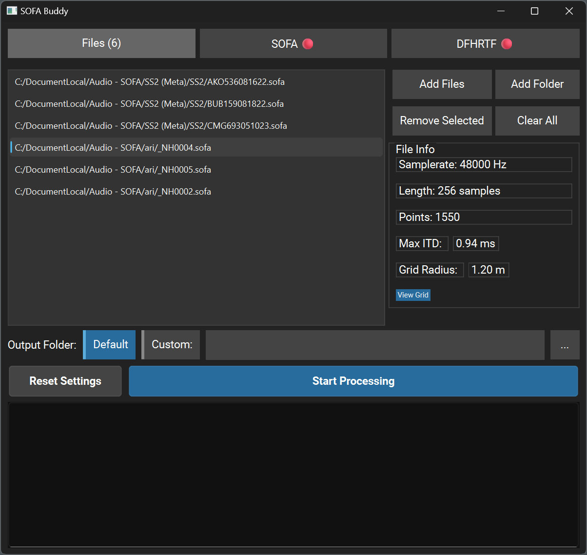
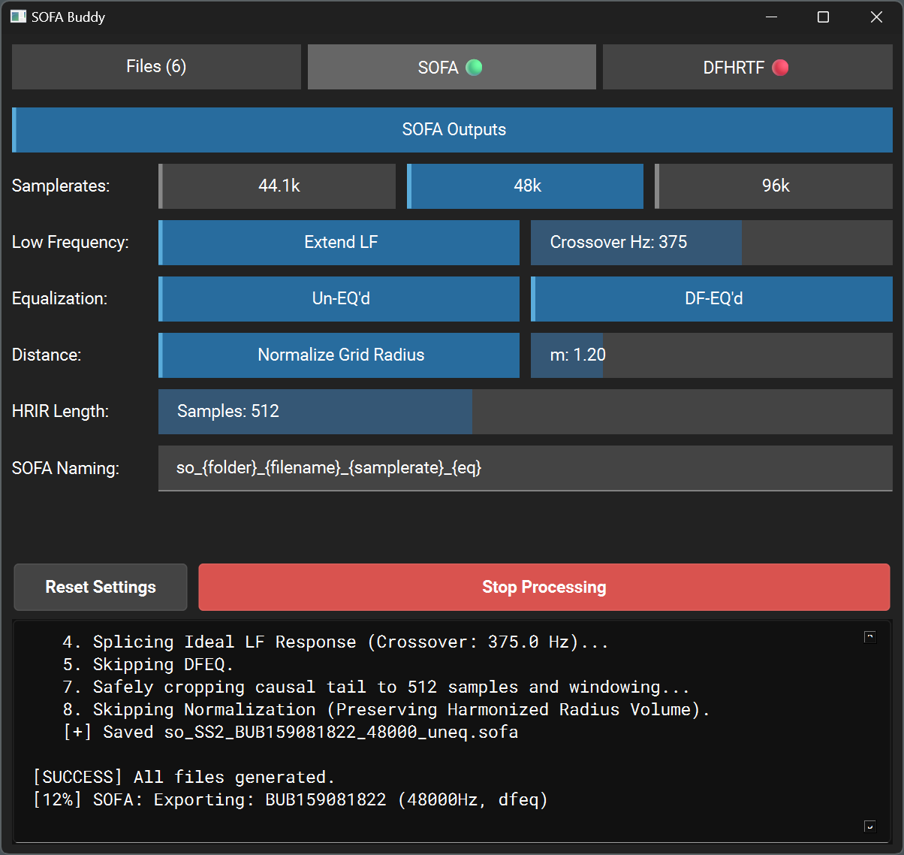
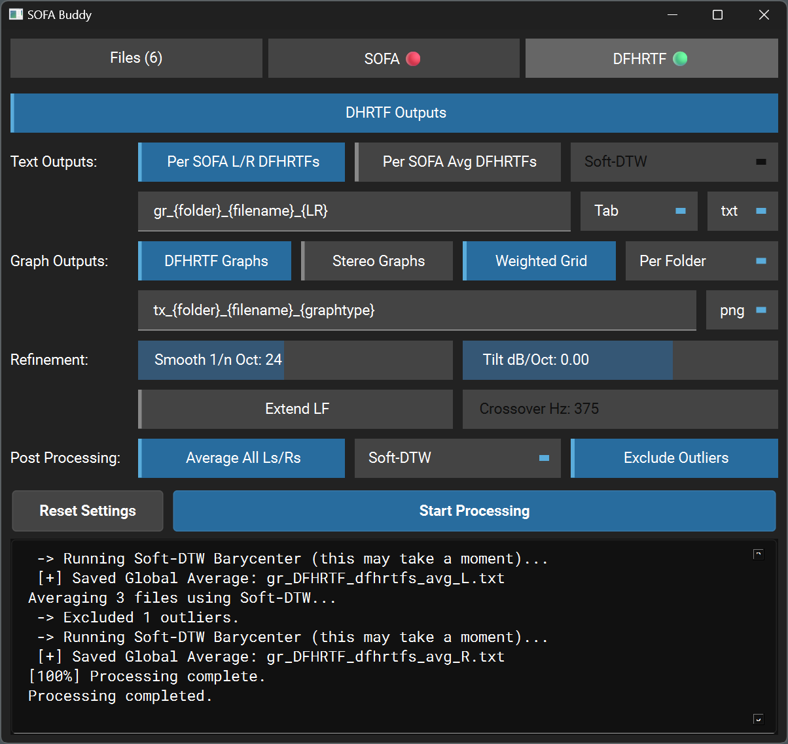
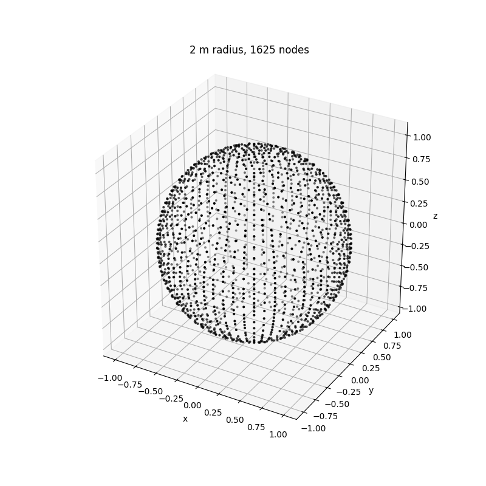

# SOFA Buddy

A desktop GUI for mastering SOFA HRTF files and extracting diffuse-field HRTF (DFHRTF) responses.

**SOFA** (Spatially Oriented Format for Acoustics) is the standard file format for head-related transfer functions (HRTFs) — the acoustic fingerprint of how sound reaches your ears from different directions. A **diffuse-field HRTF (DFHRTF)** is the average spectral response across all measurement directions, solid-angle-weighted to account for uneven spatial sampling; it characterizes the coloration introduced by the head and ears independent of sound direction, and is used for headphone equalization, quality analysis, and comparing HRTFs across measurement labs.

## Screenshots





## Features

- **Two-stage processing pipeline**: SOFA mastering (resample, LF extension, DF equalization, radius normalization, crop/window to target length) → DFHRTF extraction (smoothed magnitude curves and plots)
- **Multiple samplerates** in one run: 44.1 kHz, 48 kHz, 96 kHz
- **Geometry-weighted diffuse-field calculation** using convex-hull solid-angle weights — denser measurement regions don't bias the result
- **Three averaging algorithms** for global and per-SOFA averages: Arithmetic Mean, Geo-Arc-Length, and Soft-DTW barycenter
- **Outlier exclusion** filters anomalous curves before averaging
- **Grid visualization**: inspect measurement grids as 3D scatter plots; export solid-angle weight maps
- **Flexible filename templates** with `{filename}`, `{folder}`, `{samplerate}`, `{eq}`, `{tilt}`, `{LR}`, `{graphtype}`, and `{algo}` variables
- **Config persistence**: all settings auto-save and restore across sessions; Reset Settings returns to factory defaults
- **Default and Custom output folder modes**

## Installation

Requires Python 3.10+.

```bash
pip install -r requirements.txt
```

UI tests additionally require `pytest-qt` (not in `requirements.txt`):

```bash
pip install pytest-qt
```

## Quick Start

1. Launch the app:
   ```bash
   python main.pyw
   ```
2. On the **Files** tab, click **Add Files** or **Add Folder** to load `.sofa` files.
3. Enable **SOFA Outputs** on the SOFA tab and/or **DFHRTF Outputs** on the DFHRTF tab.
4. Choose an Output Folder mode (Default or Custom) at the bottom of the Files tab.
5. Click **Start Processing**.

## The Three Tabs

### Files Tab

The Files tab manages your input files and output destination.

- **File list**: Add `.sofa` files individually (**Add Files**) or scan a whole folder (**Add Folder**). Select a file to view its metadata — samplerate, impulse-response length, measurement point count, and optionally Max ITD and Grid Radius (computed on demand via their **Calculate** buttons).
- **View Grid**: Opens a 3D scatter plot of the selected file's measurement grid. The window is titled with the source filename so multiple plots stay identifiable.
- **Remove Selected / Clear All**: Remove individual files with the button or by right-clicking the list; **Clear All** empties everything.
- **Output Folder**:
  - **Default** — each source file's outputs land in `sofa_mastered/` and `DFHRTF/` subfolders next to that file. Files spanning multiple folders each get their own per-folder average.
  - **Custom** — all outputs go under a single chosen root folder. Global averaging produces one combined average across all files.

### SOFA Tab

Controls the SOFA mastering stage. Toggle **SOFA Outputs** on to enable.

| Setting | Description |
|---|---|
| Samplerates | Which output samplerates to produce: 44.1k / 48k / 96k |
| Extend LF | Replace sub-crossover magnitudes with an ideal reference curve |
| Crossover Hz | Transition frequency for LF extension (default 375 Hz) |
| Un-EQ'd | Include unequalized SOFA output variants |
| DF-EQ'd | Include diffuse-field-equalized output variants |
| Normalize Grid Radius | Harmonize all HRIRs to a target measurement distance |
| Distance (m) | Target radius in metres (default 1.2 m) |
| HRIR Length | Output impulse-response length in samples (default 512) |
| SOFA Naming | Filename template for output `.sofa` files |

### DFHRTF Tab

Controls DFHRTF extraction and averaging. Toggle **DFHRTF Outputs** on to enable. When SOFA Outputs are also enabled the mastered SOFAs are used as the source; otherwise the raw imported files are used.

**Text Outputs**

| Setting | Description |
|---|---|
| Per SOFA L/R DFHRTFs | Separate left-ear and right-ear DFHRTF magnitude text files per source SOFA |
| Per SOFA Avg DFHRTFs | Averaged L+R DFHRTF magnitude text file per source SOFA |
| Avg Algo | Algorithm for the per-SOFA L+R average |
| Text filename | Filename template for text output files |
| Delimiter | Tab, Comma, Semicolon, or Space |
| Extension | `txt` or `csv` |

**Graph Outputs**

| Setting | Description |
|---|---|
| DFHRTF Graphs | Diffuse-field response plots (L and R overlayed) |
| Stereo Graphs | ±30° frontal-plane plots (left-ear left channel, right-ear right channel) |
| Weighted Grid | Solid-angle weight map of the measurement grid |
| Scope | **Per Folder**: one representative plot per source folder; **All Files**: one plot per SOFA file |
| Graph filename | Filename template for graph output files |
| Extension | `png` or `jpg` |

**Refinement**

| Setting | Description |
|---|---|
| Smooth 1/n Oct | Octave-fraction smoothing: 3, 6, 12, 24, or 48 |
| Tilt dB/Oct | Spectral tilt centered at 1 kHz (range −2 to +1 dB/oct) |
| Extend LF | Linearize sub-crossover frequency response |
| Crossover Hz | Transition frequency for LF extension (default 375 Hz) |

**Post Processing — global averaging**

| Setting | Description |
|---|---|
| Average All Ls/Rs | Compute a global average across all Per SOFA L/R outputs (requires Per SOFA L/R to be on) |
| Algo | Averaging algorithm (see below) |
| Exclude Outliers | Filter curves more than 1 std deviation above the median pairwise distance |

## Output Layout

With **Default** output mode and the default naming templates:

```
<source folder>/
├── sofa_mastered/
│   └── so_<folder>_<name>_<samplerate>_<eq>.sofa
└── DFHRTF/
    ├── gr_<folder>_<name>_L.txt
    ├── gr_<folder>_<name>_R.txt
    ├── tx_<folder>_<name>_df.png
    └── dfhrtfs_avg_<algo>.txt     ← global average for this folder
```

With **Custom** output mode the same structure lands under the chosen root and one global average spans all files.

## Filename Template Variables

All filename fields support substitution variables enclosed in `{` `}`:

| Variable | Expands to | Available in |
|---|---|---|
| `{filename}` | Source SOFA filename (no extension) | SOFA naming, DFHRTF text, DFHRTF graphs |
| `{folder}` | Source file's parent folder name | SOFA naming, DFHRTF text, DFHRTF graphs |
| `{samplerate}` | Output samplerate (e.g. `48000`) | SOFA naming, DFHRTF text, DFHRTF graphs |
| `{eq}` | EQ variant: `uneq` or `dfeq` | SOFA naming only |
| `{tilt}` | Spectral tilt value in dB/oct (e.g. `0.0`, `-0.5`) | DFHRTF text, DFHRTF graphs, global-average text |
| `{LR}` | Channel: `L`, `R`, or `Avg` | DFHRTF text only |
| `{graphtype}` | Plot type: `df`, `stereo`, or `weighted` | DFHRTF graphs only |
| `{algo}` | Short algorithm name: `arithmean`, `geoarc`, `softdtw` | Global-average text files only |

`{folder}` is especially useful in multi-folder batches: each output file is stamped with the name of its source folder, keeping files from different subjects or sessions distinct even when collected into a shared output directory.

## Averaging Algorithms

Three algorithms are available for both **global averages** (Post Processing) and **per-SOFA L+R averages**:

**Arithmetic Mean** — Point-by-point mean on the normalized log-frequency grid. Fast and straightforward; works well when curves are closely clustered.

**Geo-Arc-Length** — Iterative parametric blend that minimizes geometric arc-length error between the candidate average and each input curve. Better at preserving peaks and dips than a straight mean when curves vary in shape.

**Soft-DTW Barycenter** — L-BFGS-B optimization minimizing soft dynamic-time-warping loss (via `tslearn`). Most robust when curves differ in spectral shape or magnitude; slowest of the three.

**Outlier Exclusion** — Before averaging, curves beyond `median + N × std` of pairwise distances are discarded. The threshold `N`, DTW gamma, and other averaging tunables can be adjusted in `user_settings.json` under the `averaging` key.

## Grid Visualization

**View Grid** (Files tab) opens a 3D scatter plot of the measurement grid for the selected SOFA file, with the window title set to the source filename.

**Weighted Grid** (DFHRTF tab) saves a plot of the solid-angle-weighted grid used in the DFHRTF calculation — point sizes and colors encode each node's relative weight. Use **Per Folder** scope for one representative plot per source folder, or **All Files** for a plot per SOFA file.



## Settings and Persistence

Settings are automatically saved to `user_settings.json` whenever you start processing or close the app. The next session restores all tab state from this file. **Imported file paths are never saved.**

| Platform | Location |
|---|---|
| Windows | `%LOCALAPPDATA%\SOFA Buddy\user_settings.json` |
| Linux | `~/.config/SOFA Buddy/user_settings.json` |
| macOS | `~/Library/Preferences/SOFA Buddy/user_settings.json` |

**Reset Settings** (main window toolbar) deletes `user_settings.json` and restores factory defaults.

Advanced tunables not exposed in the UI can be edited directly in `user_settings.json`. Keys live under `sofa.advanced`, `dfhrtf.advanced`, and `averaging`. The app validates and sanitizes all JSON edits on load — out-of-range values are clamped and invalid choices are reverted to defaults with a warning in the console.

## Running Tests

```bash
pytest tests/                   # all tests (requires pytest-qt for UI tests)
pytest tests/test_config.py     # config tests only — no Qt dependency
```

## License

This project is licensed under the MIT License — see the [LICENSE](LICENSE) file for details.
